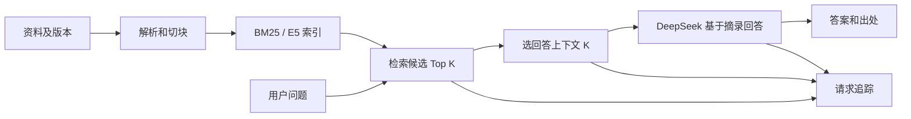

# 从零上手并学会这个 RAG 项目

> 适合会一点 Python、用过大模型 API，但想真正弄清 RAG 工程链路的读者。预计先花 30 分钟跑通，再分几次完成练习。本文只讲仓库里**已经存在的实现和实验**；要扩展的功能会单独标明。

## 阅读路线

| 时间 | 做什么 | 读完能回答 |
| --- | --- | --- |
| 10 分钟 | 第 1–2 章，跑通免费检索 | 资料怎样变成可检索的知识块？ |
| 20 分钟 | 第 3–6 章，看一条真实问答 | BM25、E5、RRF、上下文与引用各负责什么？ |
| 分次练习 | 第 7–10 章，复现实验、换资料 | 错了怎样定位？换场景怎样验证？下一步该优化什么？ |

目录：**1. 项目边界与最小运行 → 2. RAG 全链路 → 3. 资料、切块与版本 → 4. 三路检索 → 5. 上下文选择与回答 → 6. 页面追踪 → 7. 评测与失败定位 → 8. 换场景和 PDF → 9. 实操练习 → 10. 扩展路线**。

---

## 1. 这个项目是什么，怎样先跑起来

第一次运行，双击根目录的 [start.cmd](../start.cmd)，打开终端打印的地址。选 L02，点「运行单路检索」，展开首块，点第 6 页核对同一行的评分与优先级。想尝试真实问答时，再按指南切换到 `--live`，对照 L08 拒答和输入失败。下面继续从 CrewAI 的 BM25 建库开始。[演示指南](DEMO.md)

它是一个**技术文档问答 RAG 骨架**：把资料、页面展示和评测题放在场景包中，核心解析、索引、检索、问答代码共用。目前有固定版本的 CrewAI、Pydantic 文档，以及可自行上传 Markdown/MDX/文本型 PDF 的本地场景。它是一条由程序固定编排的 RAG 问答流程，**还不是会自主决定工具调用的 Agent**。

项目中“已能用”和“仍在实验”要分开：

| 能力 | 当前状态 |
| --- | --- |
| Markdown/MDX、文本型 PDF 入库；PDF 页码引用 | 已用多份真实 PDF 验证，复杂版面仍可能丢失图注、表格或脚注证据 |
| SQLite FTS5/BM25、E5 向量、RRF 混合检索 | 已实现；E5 需另装依赖和下载模型 |
| DeepSeek 带出处回答、请求记录、人工答案评审 | 已实现；DeepSeek API 可选且会消耗额度 |
| 条件父块合并＋目标邻块、多查询、自动拆题 | 可选实验；不能把个别题改善当成通用效果 |
| 中文问题自动生成可编辑英文 BM25 查询 | 已接入 v3；10 题证据覆盖比 v1 多 1 题，尚待全新题验证 |
| OCR、模型语义切分、Agent 编排 | 尚未完成 |

以下命令在 Windows PowerShell 执行，使用 Git 和 Python 3.11 或更新版本。如果还没有仓库，先执行 `git clone https://github.com/mingyuzi123/RAG.git` 和 `cd RAG`；已有仓库则直接在仓库根目录继续。第一次只做**免费**的 CrewAI 关键词检索：

```powershell
python -m venv .venv
.\.venv\Scripts\python.exe scripts/fetch_scenario_docs.py --scenario scenarios/crewai/manifest.json
.\.venv\Scripts\python.exe -m raglab index
.\.venv\Scripts\python.exe -m raglab search "What do role goal and backstory mean in an Agent?" --strategy bm25 --top-k 3
.\.venv\Scripts\python.exe -m unittest discover -s tests -q
```

正常结果：先得到版本化 SQLite 索引路径和知识块数量，再看到按排名列出的块 ID、标题路径、原文行号、内容摘录及链接。下载官方固定版本资料需要网络；资料保存在 Git 忽略的 `data/`，索引保存在 `indexes/`。读者可先不配置 API Key，也不安装 E5。

要打开免费的检索页面：

```powershell
.\start_lab.cmd --offline
```

浏览器访问 [本地实验室](http://127.0.0.1:8765/)，保持启动窗口打开。免费起步时选择「BM25」并填英文检索词。若需要 E5 和混合检索，再安装向量依赖并建索引：

```powershell
.\.venv\Scripts\python.exe -m pip install -r requirements-vector.txt
.\.venv\Scripts\python.exe -m raglab vector-index
```

首次 E5 建库会下载固定版本模型，耗时取决于网络和机器。若要进行真实 DeepSeek 回答，在本机 `.env` 填好 `DEEPSEEK_API_KEY`。没有该文件时，先复制 `.env.example`。在原窗口按 `Ctrl+C` 停止服务，再双击 [start_lab.cmd](../start_lab.cmd)。看到「DeepSeek 已启用」即可在页面生成回答。未配密钥时会进入免费检索；需要强制检查是否已配置密钥，可运行 `.\start_lab.cmd --live`。端口被占用时可运行 `.\start_lab.cmd 8769`，打开终端打印的地址。`.env` 被 Git 忽略。

要回顾 Pydantic，先按 [README 的第二场景步骤](../README.md#第二场景pydantic-文档)建库，再从现有页面切换知识库。

**本章自检：**`search` 输出了什么？其中哪一项能让你回到原文，而不必相信模型的记忆？

## 2. 先画出一条 RAG 链路



离线步骤是“资料 → 块 → 索引”，在线步骤是“问题 → 候选 → 上下文 → 回答”。**候选 Top K**是可能有用的证据；**上下文 K**是实际交给模型的证据。比如正确块排第 8：候选 Top 10 找到了它，但上下文只取前 3 时，回答模型仍看不到它。增大 Top K 只扩大候选池，不保证最终答案改善。

代码入口：命令行在 [`raglab/__main__.py`](../raglab/__main__.py)，页面在 [`raglab/web.py`](../raglab/web.py)，共同调用 [`raglab/service.py`](../raglab/service.py)。后者保存每次请求的候选、所选块、回答、引用、耗时和 token 用量到本机 `logs/requests.jsonl`。

**本章自检：**若正确答案在原 PDF 第 5 页，但该页根本没有被解析成块，调大上下文 K 能补救吗？提示：先找链路中最早发生的缺口。

## 3. 资料怎样变成知识块，为什么要保留版本

CrewAI/Pydantic 的 [`manifest.json`](../scenarios/crewai/manifest.json)固定上游 Git 提交、文件列表与原文 URL。Markdown/MDX 由 [`raglab/corpus.py`](../raglab/corpus.py)按标题、段落、表格行切块，保留标题路径和行号。知识块 ID 包含资料版本、路径、位置和正文；替换资料后旧块不会被误当成新块。

本地场景的导入与替换在 [`raglab/local_sources.py`](../raglab/local_sources.py)。同名资料必须明确勾选替换；旧文件和索引仍留在本机，新问答只使用当前 manifest 指向的版本。PDF 则由 [`raglab/pdf_source.py`](../raglab/pdf_source.py)按页提取、再按段落与长度切块。每个 PDF 块只属于一页，出处链接使用 `#page=N`；Markdown 仍引用行号。纯扫描件没有可提取文字时拒绝空导入，部分文字不足的页显示 OCR 提示。

这一步还**没有模型辅助语义切分**。当前结构切分是可复核的基线：先保证“不丢内容、能回原文”，再用题集比较语义切分是否真的提升答案。页码正确也不等于双栏顺序、表格关系正确；真实 PDF 仍要人工抽查。[PDF 验收记录](PDF_接入边界与验收.md)写明已测和未测。

**延伸知识：**“内容哈希”可用于判断两段文字是否相同；“快照版本”用于说明某次回答依据的是哪一批资料。两者不是同一个概念。详见[替换实验](LOCAL_DOC_VERSION_EXPERIMENT.md)。

## 4. BM25、E5 和 RRF 分别做什么

[`raglab/store.py`](../raglab/store.py)把块写入 SQLite FTS5，用 BM25 按词语匹配排序。它适合 `manager_llm`、`expected_output` 这类精确术语；当前英文资料的 BM25 需要英文关键词。BM25 分数是这一检索器内部的排序信号，不与向量余弦分数直接相加。

页面中的英文词若留空，[`raglab/query_rewrite.py`](../raglab/query_rewrite.py)会先用 DeepSeek 从中文问题生成一条英文关键词查询，再交给 BM25；E5 仍使用中文原题。生成词会显示在输入框，用户可以修改。请求记录写明英文词来自自动改写还是人工填写，并保留提示词版本和额外 token 用量。固定历史评测仍用人工词，不能与自动词成绩混写；6 题对照见[自动查询试测](../reports/AUTO_QUERY_PILOT.md)：前 3 标注证据覆盖为自动 4/6、人工 5/6，C14 自动词让一侧证据从第 2 掉到第 4。

后续按 C14 的 `difference` 干扰词修正提示词。v2 一概删除比较词，使 C01 候选退步；v3 保留连接具体概念的 `vs`，固定 10 题前 3 覆盖由 v1 的 7/10 到 8/10，但净增仅来自已知 C14，最初留出的 4 题没有改善；C01 已参与 v3 调整，不能再作为其独立留出题。请看[逐题对照](../reports/QUERY_REWRITE_V3.md)，练习解释“已知题修好”和“新题收益得到验证”为何不同。

[`raglab/vector.py`](../raglab/vector.py)使用固定版本的 multilingual E5：文档前加 `passage:`，问题前加 `query:`，编码后归一化，用点积排序。它可以用中文问题查英文文档，但语义相近不等于事实正确，也可能把只“谈到类似话题”的块排得很高。

[`raglab/hybrid.py`](../raglab/hybrid.py)用 RRF 融合两路**排名**，默认常数 60：

```text
同一块的融合分 = 1 / (60 + BM25 名次) + 1 / (60 + E5 名次)
```

只在一路出现的块只得一路的分；两路都靠前的块通常会被共同推高。这里融合的是**名次**，避免 BM25 与 E5 原始分数尺度不同。RRF 也无法救回两路候选都没有的答案。

免费比较一题时，先建立 E5 索引，再在页面选 CrewAI 的 C02，输入预置英文检索词，点“对比三路检索”。记录标注证据在三路的名次，观察它是否进入前 3。若只想用命令行：

```powershell
.\.venv\Scripts\python.exe -m raglab search "Agent 的 role、goal、backstory 分别表示什么？" --strategy hybrid --search-query "What do role goal and backstory mean in an Agent?" --top-k 10
```

**本章自检：**BM25 第 1、E5 没进候选，与 BM25 第 4、E5 第 3 的块，哪个更可能被 RRF 排前？先算两个分数，再看项目实际排序。

## 5. 为什么“检索到了”仍可能答不全

[`raglab/service.py`](../raglab/service.py)默认从候选中直接取前 K 块作为回答上下文；[`raglab/generation.py`](../raglab/generation.py)把编号摘录交给 DeepSeek，要求重要断言引用 `[1]`、`[2]`，证据不足时说明不足。**引用编号有效**只表示编号指向真实送入的块，不保证这块真的支持那句话，所以页面另有人工核验入口。

可选的“条件合并＋目标邻块”在 [`raglab/context_window.py`](../raglab/context_window.py)：同一父块至少两个子块进入 Top 10、且占该父块子块总数**超过一半**时，才尝试回填完整父块；若其前一邻块与尚未覆盖的英文查询词相关，则最多补一个邻块。最终最多 K 块，正文字符数不超过原前 K 块的总量。这是本项目参考父子块和窗口思想做的实验实现，不是所有问题都默认扩展。

旧 35 题单次真实回答的完整题数由 **29/35 到 33/35**，但调规则时看过部分题，不能当独立泛化证明。之后先冻结的 10 道新题，两策略都 **10/10**；基线已全对，是天花板效应。两份记录分别在[邻块实验](../reports/TARGETED_WINDOW_EXPERIMENT.md)和[新题复验](../reports/FRESH_CONTEXT_V1.md)。

**本章自检：**父块有 4 个子块，2 个进入 Top 10。会合并吗？答案线索：规则是“超过”一半，不是“大于等于”。

## 6. 用页面看见“模型实际收到了什么”

页面依次看四处：**问题与策略 → 三路候选排名 → 进入上下文的块 → 回答与引用**。点击候选标题或答案出处可以回原文。CrewAI/Pydantic 链接定位到 GitHub 文件行；本地 PDF 定位到原文件页。问题集选择器可以快速复现 C02、C04、P01 等案例；自定义问题也能问，但没有预设答案要点，需自己核查。

“请求记录”保留当次使用的场景、资料版本、检索候选、所选块和模型输出。评测题还可以逐要点人工评审。请求日志和评审日志不提交 Git；把截图当证据前，先确认它与当前资料版本、策略、Top K、上下文 K 一致。

### 一次可重复的页面实验

1. 选择 CrewAI C04，先用预置英文查询运行“混合 RRF”。看 Agent 与 Task 两侧证据是否都进入前三。
2. 选择“多查询覆盖”，分别输入 Agent tools 与 Task tools 的子问题，再跑一次。
3. 只比较候选和上下文；若要生成回答，再点 DeepSeek 按钮并检查每条主要断言的原文支持。

这一实验展示“一个问题包含两个检索意图”时的候选覆盖问题。人工拆题在 C04 改善，C14 却退步；因此不要把一个成功截图当成整体正确率。[实验记录](../reports/README.md)保存了逐题结果。

## 7. 怎样做评测，避免只挑成功案例

评测至少分三层：

| 层 | 要问的问题 | 典型故障 |
| --- | --- | --- |
| 原文与解析 | 正确事实在文档吗？被抽成可检索块了吗？ | PDF 扫描页空文本、表格列关系丢失 |
| 召回与上下文 | 正确块进入 Top 10 吗？进入最终 K 块吗？ | C04 两侧证据分散；P01 缺邻块 |
| 回答与引用 | 答案要点完整吗？每条引用支持断言吗？ | 章节命中却没答全；编号有效但语义不支持 |

`Recall@10` 或项目里的“候选命中”回答**有没有找到**；“上下文命中@3”回答**有没有交给模型**；完整答案和人工引用核验才接近用户关心的质量。这些指标不能互相代替。

做策略对照时，先冻结资料版本、题目、英文查询、预期要点和证据位置；再固定 Top K、上下文 K、模型与提示词，只改一个主要策略。逐题报告**进步、退步、没变**，记录延迟和 token。旧题上调过的规则要拿新题复验；若新题基线已经全对，应承认天花板效应，换有区分度但预先冻结的困难题。实际范例见[新题复验](../reports/FRESH_CONTEXT_V1.md)。

**本章自检：**一个新策略让 Recall@10 上升，但最终 K=3 里的正确证据没变。能宣布回答正确率提升吗？先指出它改善了链路的哪一步。

## 8. 怎样换“皮”：资料、配置、评测与页面

换固定技术文档场景时，建立独立 `scenarios/<name>/manifest.json`、`ui.json`、`eval/questions.jsonl`；准备可固定版本的原文，建该场景自己的索引，逐题验证证据与答案。CrewAI 和 Pydantic 已证明**同一套核心代码**可运行不同技术文档，不代表任意 PDF 或行业语料无需调整解析和标注。

| 可替换部分 | 当前入口 | 更换后必须核对 |
| --- | --- | --- |
| 资料和版本 | 场景 `manifest.json`，或本地上传 | 来源、哈希/提交、页码或行号、旧索引隔离 |
| 页面文案 | 场景 `ui.json` | 题集、展示名、链接是否指向当前资料 |
| 评测题 | 场景 `eval/` | 预期证据是否真实存在，是否覆盖无答案题 |
| 检索策略 | 页面/CLI 参数 | 新语料上逐题召回和上下文覆盖 |
| E5 模型与生成提示词 | 当前仍在 `raglab/vector.py` 与 `raglab/generation.py` | **尚未做到纯配置替换**，修改后需重建索引或复测回答 |

导入自己的 PDF：进入 `?scenario=local-docs` 的“资料管理”，上传不超过 8 MB、200 页的可复制文字 PDF；同名替换要勾选。随后选 **E5 向量**用中文提问，查看候选的“第 N 页”，点击链接核对原页。整份无文字会提示需要 OCR；页码可点开也不等于版面提取顺序一定正确。PDF 的真实版面验收清单见[PDF 接入记录](PDF_接入边界与验收.md)。

## 9. 四个练习：从会用到能解释

每个练习先写下预测，再看页面和报告，最后用三句话记录“问题、证据、结论”。

1. **候选与上下文：**在 C04 的混合检索中找 Agent 与 Task 两侧块，分别写下名次和是否进入回答 K=3。提示：若一侧在第 19，单纯调换前三顺序无济于事。[核对材料](../reports/README.md)。
2. **上下文扩展：**在 P01 对比直接取前 K 与目标邻块，找到“没有默认值的字段必填”那句原文出现在哪个块、对应哪条引用。提示：别只看两个回答是否都流畅。[核对材料](../reports/TARGETED_WINDOW_EXPERIMENT.md)。
3. **PDF 证据：**上传一份你有权使用的文本型 PDF，问一个答案明确写在某页的问题。记下页码、原文句子、回答断言和引用链接，检查四者能否对齐。若是双栏或表格，先人工检查抽取顺序。
4. **实验判断：**解释为什么新冻结 10 题的 10/10 对 10/10 既是有用的回归检查，又不能证明新规则提高准确率。[核对材料](../reports/FRESH_CONTEXT_V1.md)。

可把记录写成五行：`问题 → 我预测的证据 → 实际候选/上下文 → 答案及引用是否受支持 → 下一次只改什么`。这比只记一个“检索成功率”更适合复盘，也更能在面试中讲清自己的判断。

## 10. 下一步扩展与面试表达

6A 用 N02 查表格跨块，用 N04 查候选漏召回，再用 N01 看证据从第 1 移到第 4。短块减少后，前 3 的完整证据覆盖反而下降。复习时把每个案例标在「原页 → 索引 → 候选 → 上下文」的第一个缺口。[6A 对照报告](../reports/STAGE6A_PDF_CHUNKING.md)

第 5 阶段已完成。用 `python -m raglab doctor` 查看资料与索引，在请求记录中按 ID 找到失败环节。真实 PDF 可以用 N03 复核页码引用，用 N02 观察相关页进入候选后仍缺表格证据的情况。[第 5 阶段交付与验收](../reports/STAGE5_DELIVERY.md)

最新可复现实验是[自动查询＋条件父块/邻块组合](../reports/QUERY_CONTEXT_COMBINED_AUDIT.md)：同一 10 题完整回答从 v3 基线 6/10 到组合 7/10，新增 P06。页面选择 Pydantic P06，使用报告保存的 v3 查询，对照“直接取前 K”和“条件合并＋目标邻块”；找到 after 的原文与回答引用 [3]，说明新增证据从哪里来，以及为什么 P01 仍未改善。

当前最值得继续的方向，按故障选择，而不是同时堆框架：

- **中文问题到英文 BM25 查询：**v3 已修复 C14 的已知排名问题，10 题覆盖由 v1 的 7/10 到 8/10，P01 仍有排名下降。下一步冻结全新题集，与旧规则、人工词和纯 E5 比较候选/上下文覆盖和真实答案，检验收益是否能推广。
- **PDF 质量**。先复习 L02 的行列关系和 L04–L06 的正文缺口，再用独立题 U05 检查表格行与脚注怎样被选入上下文。[6B 逐题验收](../reports/STAGE6B_PDF_LAYOUT.md) · [独立 PDF 验收](../reports/V1_ACCEPTANCE.md)
- **候选覆盖：**C04 这类分散证据问题可研究多查询、重排或证据覆盖选块；不要用邻块规则解决所有故障。
- **Agent 接入：**未来可把 `retrieve`/`answer` 封装成 Agent 工具，并要求 Agent 记录何时检索、用了哪版索引、最终断言依据哪些块。**本仓库目前没有多 Agent 编排**，这是延伸项目，不是现成功能。

面试时可以按“**问题 → 定位 → 只改一个变量 → 逐题结果 → 反例与限制**”讲。一个可验证的例子：P01 的标注章节进入候选，但缺少定义句；目标邻块把该句送入上下文，旧题集完整回答由 29/35 到 33/35；随后冻结的新题两策略同为 10/10，说明这组题无法证明泛化，因此保留可选实验。另一个例子是 PDF：两页合成文档已验证第 2 页引用，但不能据此宣称复杂扫描件也可靠。

复习跨文档验证时，先用 R03 判断为什么第 17 页命中了却无法回答，再用 U05 检查表格行与脚注是否一起进入模型。运行真实问答需要本机密钥。想复现稳定的链路测试，可以按报告末尾运行无密钥回归。[冻结题验收和复现命令](../reports/V1_ACCEPTANCE.md)

继续复盘可查[学习进度](../PROGRESS.md)、[回顾路线](PROJECT_回顾路线.md)和[33 道面试问答](RAG_面试问答.md)。把本章练习的判断写出来，再回头阅读这些参考答案，效果会比背术语更好。

<details>
<summary>前面几个自检题的核对提示</summary>

- 第 1 章：`source_url` 加上原文位置能回查证据；块 ID 则用于识别这次检索命中的具体版本与内容。
- 第 2 章：不能。解析时第 5 页没有入库，后面的候选和上下文选择无从取得它。
- 第 4 章：一路第 1 约为 `1/61≈0.0164`；两路第 4 和第 3 约为 `1/64+1/63≈0.0315`，后者更高。实际还要看其他候选的排名。
- 第 5 章：不会合并，`2/4=0.5` 没有**超过**一半。
- 第 7 章：只能说候选召回改善；若最终上下文与生成条件不变，不能由此宣布回答质量提升。

</details>


2026-11-06 完整回答复测：固定同一批 10 题的 v1/v3 查询，真实调用 20 次并逐要点核对实际证据，完整且有支持的回答从 **5/10 到 6/10**，新增通过 C14，无通过题退步。P01/P06 仍缺关键证据，P04 旧回答的引用格式异常单独记录。见[答案与引用逐题核验](../reports/QUERY_REWRITE_ANSWER_AUDIT.md)。
